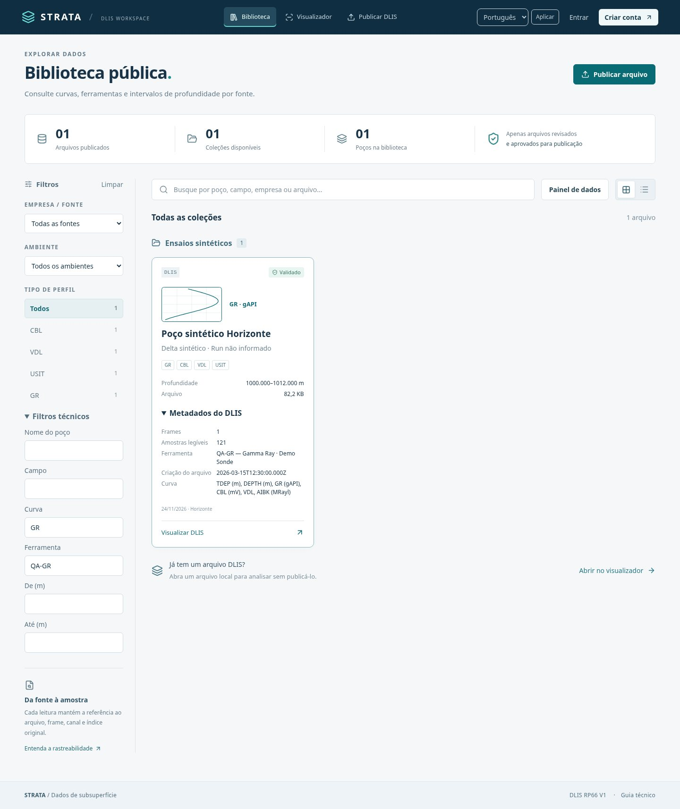

# Fase 2 · Contas, publicação e catálogo DLIS

## Reproduzir no Codespaces ou no computador

1. Na raiz da branch `feat/redesign-dlis`, execute `npm run dev`. Em outro terminal, execute `npm run seed`. Abra a porta 5173. A coleção **Exemplos sintéticos** identifica os dois poços fictícios na instalação sem `samples/`.
2. Abra **Criar conta** e cadastre um endereço. No modo local, consulte o código com `npm run local -- mail seu@email.test`. Confirme e abra **Minha conta**. Para testar envio e revisão com a mesma conta local, execute `npm run local -- role seu@email.test admin`.
3. Em **Publicar DLIS**, escolha um arquivo autorizado. Confira o poço, o campo, o intervalo, a empresa e a coleção. Confirme a autorização e envie. A publicação aparece em **Minha conta**.
4. Em **Administração**, revise o arquivo, registre o parecer e aprove. Na biblioteca de visitante, procure o poço em **Filtros técnicos**. Os filtros de profundidade aceitam um ou dois limites, em metros, e comparam cada frame legível. **Metadados do DLIS** exibe canais com suas unidades, ferramentas declaradas, data de criação e total de linhas de amostras.

## Verificações executadas

| Verificação | Evidência |
| --- | --- |
| Conta local, Chromium e D1 | Cadastro pela interface, confirmação pelo terminal, credencial Argon2id, login válido e inválido, sessão restaurada em outro contexto de navegador, logout, renovação, expiração definitiva e recuperação com troca da senha. A senha anterior foi recusada. |
| Autorização | Leitura do catálogo como visitante, redirecionamento da página protegida e 401 da API privada. A troca de origem foi recusada com 403 e o limite de tentativas devolveu 429 com `Retry-After`. O build de produção foi exercitado com provedor de teste e com configuração ausente. |
| Publicação ponta a ponta | Um arquivo inválido e um DLIS sintético foram selecionados juntos. O relatório identificou o inválido. O Worker leu as 121 linhas do arquivo válido. R2 recebeu os bytes e D1 registrou uma publicação. Um novo envio dos mesmos bytes retornou 409. O teste simulou a perda da confirmação após a gravação e repetiu a operação com o mesmo ID. |
| Revisão e catálogo | Antes da aprovação, o visitante encontrou zero arquivos. A revisão reindexou o objeto armazenado e a publicação aprovada apareceu na aba do visitante sem recarga manual. O teste combinou poço, campo, GR, ferramenta e profundidade e conferiu o primeiro ponto da miniatura e a unidade gAPI. |
| Primeira abertura do visualizador | Uma execução com cache Vite vazio revelou uma recarga ao carregar o Worker pela primeira vez. A pré-otimização das dependências corrigiu a perda da seleção. O Chromium abriu e desenhou quatro trilhas para cada um dos cinco arquivos distintos no teste de regressão. |
| Seed e migração | Segunda execução preservou registros e hashes. Um diretório temporário com um DLIS válido e um inválido importou o válido e identificou o outro pelo nome. O índice preserva campos ausentes em registros antigos. |
| Validação geral | Lint, TypeScript, 58 testes unitários, suítes de banco, testes de interface, cinco testes científicos em Python, build do Worker e integração com D1/R2. O teste ponta a ponta está incluído no GitHub Actions. |

Para repetir o teste com Chromium instalado, entre em `strata-dlis/`, execute `pnpm exec playwright install chromium --only-shell` e depois `npm run test:phase2`. Também é possível usar `PLAYWRIGHT_EXECUTABLE_PATH` para indicar o Chrome instalado. O teste cria seu próprio D1 e R2 temporários.

## Conferência com arquivos reais

Nove DLIS locais continham cinco arquivos distintos por SHA-256. A conferência independente com dlisio 1.0.4 comparou poços, campos, datas de criação, ferramentas, nomes de canais, dimensões, unidades, limites de profundidade, linhas por frame e valores numéricos. Os arquivos reais foram lidos localmente. A captura acima usa dados fictícios.

| Arquivo distinto | Frames | Linhas de amostras | Valores numéricos conferidos | Pontos da miniatura |
| --- | ---: | ---: | ---: | ---: |
| 1 | 4 | 36.331 | 29.951.964 | 64 |
| 2 | 4 | 8.413 | 7.392.324 | 65 |
| 3 | 3 | 31.169 | 42.764.682 | 63 |
| 4 | 3 | 20.820 | 17.747.261 | 65 |
| 5 | 4 | 23.460 | 26.280.702 | 65 |
| **Total** | **18** | **120.193** | **124.136.933** | **322** |

Todos os valores acessíveis comparados coincidiram. Cada ponto da miniatura foi localizado na curva e na profundidade originais. O parser informa quando encontra metadados proprietários criptografados. Frames incompatíveis recebem um erro individual. Um arquivo sem frames legíveis é recusado. A miniatura requer um canal escalar e profundidade física reconhecida. Campos ausentes permanecem vazios. A data é a criação declarada em ORIGIN, com sufixo Z somente quando o arquivo indica GMT.

Com dados autorizados próprios, a comparação pode ser repetida com `python scripts/verify-reference.py /caminho/dos/arquivos`, depois de instalar `science/requirements.txt`.

## Ambiente de autenticação

O modo local usa Argon2id com 19 MiB, duas iterações, paralelismo 1 e sal aleatório. O access token local vale uma hora. A sessão tem duração máxima de 30 dias e renova os tokens por rotação. Os cookies de sessão usam HttpOnly e SameSite=Lax, com Secure em HTTPS. A API verifica a origem das mutações e limita tentativas por ação e endereço de e-mail e, quando fornecido pela Cloudflare, por IP.

A autenticação hospedada continua no Supabase, que documenta o uso de bcrypt. A entrega de códigos pelo SMTP institucional e as políticas de duração configuradas naquele projeto dependem de homologação no ambiente da instituição. [Segurança das senhas no Supabase](https://supabase.com/docs/guides/auth/password-security) · [Parâmetros Argon2id da OWASP](https://cheatsheetseries.owasp.org/cheatsheets/Password_Storage_Cheat_Sheet.html) · [RP66 V1, representação DTIME](https://energistics.org/sites/default/files/RP66/V1/rp66v1_appb.html)
